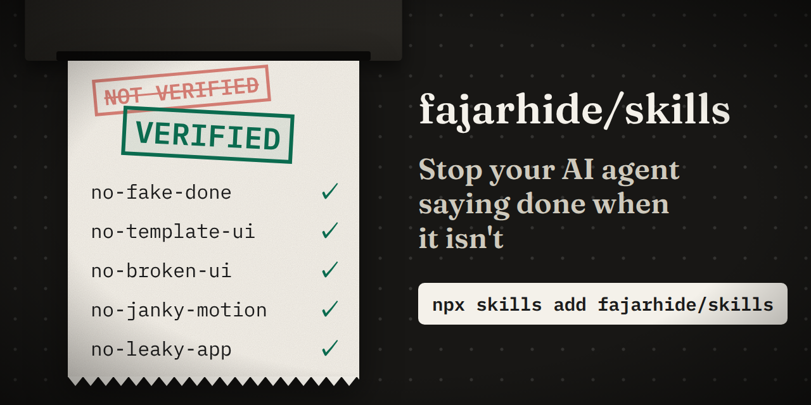
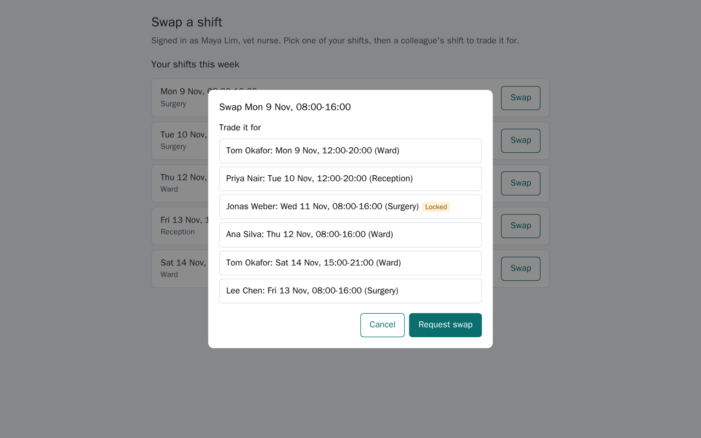
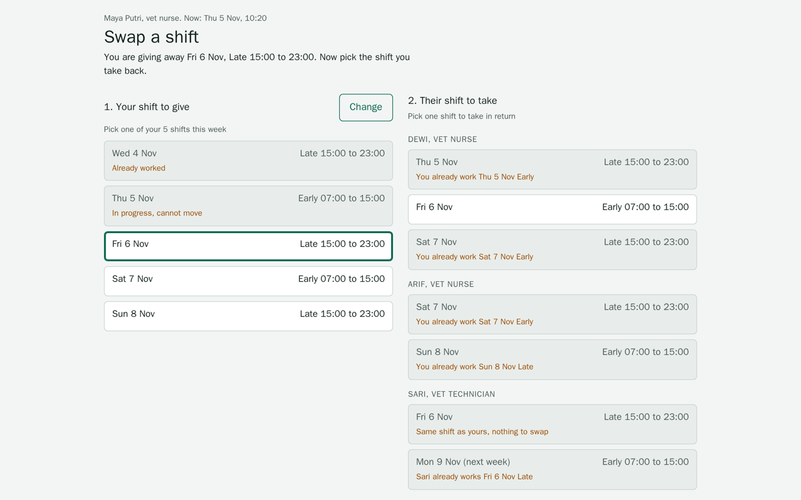
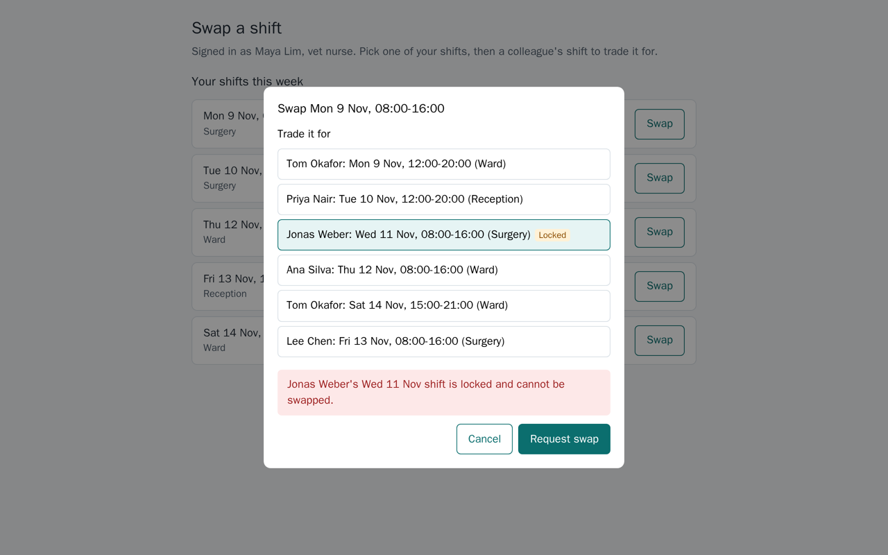
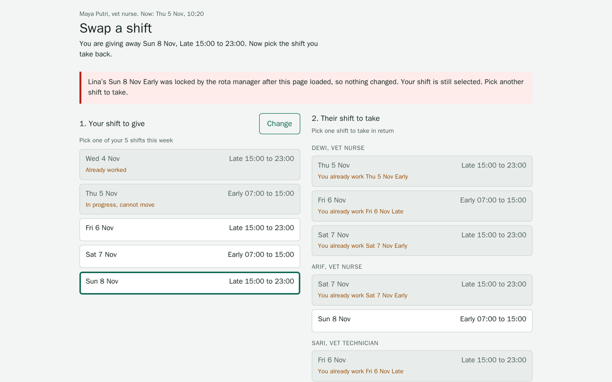

# no-fake-done

<p align="center"></p>

Stop your AI agent saying done when it isn't.

Vibe coding gets you to a demo fast. Then the agent says "done" about a button nobody clicked, a page that renders blank, a PR whose tests pass while the screen is broken, and you find out in front of a customer. What separates that from professional work is everything around the code: deciding what done means before starting, checking the result in a real browser, trying what can go wrong, and leaving proof a reviewer can check.

These five skills make your agent do that part. Every claim carries a receipt: a test, a number measured in a real browser, a screenshot, or a step you can repeat. Anything the agent could not check is written down as Not verified. You keep prompting the way you do now. They are for web work, from a one-line request to a PR.

| Skill | Use it when | You get back | skills.sh |
| --- | --- | --- | --- |
| [`no-fake-done`](skills/no-fake-done/README.md) | You are building a feature or fixing a bug, from a one-line request to a PR | A spec on disk, the change, and a PR whose every acceptance row has its receipt | [](https://www.skills.sh/fajarhide/no-fake-done/no-fake-done) |
| [`no-template-ui`](skills/no-template-ui/README.md) | You are building a new page or a page looks generic | The page, plus a `DESIGN.md` that records why it looks the way it does | [](https://www.skills.sh/fajarhide/no-fake-done/no-template-ui) |
| [`no-broken-ui`](skills/no-broken-ui/README.md) | A page exists and you want to know what is wrong with it | Up to ten ranked findings, each with the action, number or labelled judgment behind it | [](https://www.skills.sh/fajarhide/no-fake-done/no-broken-ui) |
| [`no-janky-motion`](skills/no-janky-motion/README.md) | A page animates and you want to know whether it should, and whether it holds up | Animations measured in four browser runs, and up to ten findings with their numbers | [](https://www.skills.sh/fajarhide/no-fake-done/no-janky-motion) |
| [`no-leaky-app`](skills/no-leaky-app/README.md) | A web app you own is about to launch and you want its headers, cookies and caching right on every response | Before and after headers for each kind of response, and the fixes in one place | [](https://www.skills.sh/fajarhide/no-fake-done/no-leaky-app) |

## From a prompt to a PR you can merge

What a careful engineer does around a change, and the skill that has your agent do it:

| A professional would | Without a skill, agents in our runs | The skill |
| --- | --- | --- |
| Write down what done means before coding | kept the plan in their heads, 2 of 2 | `no-fake-done` puts a spec on disk with a receipt named for every acceptance row |
| Keep the change to what was asked | shipped an unrequested refactor, 2 of 2 | `no-fake-done` traces every changed line to a row and splits the rest out, though 2 of 4 runs with it still rewrote code nobody asked about |
| Give a new page a look of its own | produced pages marked as generic AI output, 4 of 4 | `no-template-ui` builds from what only that subject has |
| Click through it before calling it done | said "done" about a button nobody had opened, 1 of 2 | `no-broken-ui` drives the page and forces failures, empty states and the phone |
| Check what it feels like on a slow device | (not measured) | `no-janky-motion` measures every animation in four browser runs |
| Check headers and caching before launch | left 6 of 21 gaps open in one round, tied in the other | `no-leaky-app` checks every kind of response the app sends |
| Hand the reviewer evidence, not a summary | wrote PRs with no receipts, 3 of 3 | `no-fake-done` builds the PR body from the acceptance table |

Two checks keep this honest without relying on the agent's word. `skills/no-fake-done/scripts/receipts.py` fails a spec or PR body with an empty or filler receipt, or one that names a file the repo does not have, so a git hook or CI job can run it whichever agent wrote the code. In Claude Code, `no-broken-ui` also holds the first "done" after an unprobed UI change until the page is checked or named as Not verified.

## The receipts method

Every skill here follows the same four rules.

1. **No receipt, no claim.** A statement about the work comes with something a reader can check without trusting the agent. What could not be checked is listed as Not verified, never as passing.
2. **Run it, do not read it.** Behaviour is observed in a browser or a terminal. Source code is read afterwards, to find the line to change.
3. **Force what the happy path hides.** Double submits, failed requests, empty states, long text, a phone, the keyboard, reduced motion.
4. **Publish the losses.** Each README reports the rounds a skill lost next to the ones it won, and `evals/` holds what you need to run them again.

## Install

```sh
# All five skills, for your user
npx skills add fajarhide/no-fake-done -g

# Or one of them
npx skills add fajarhide/no-fake-done --skill no-template-ui -g
npx skills add fajarhide/no-fake-done --skill no-broken-ui -g
npx skills add fajarhide/no-fake-done --skill no-fake-done -g
npx skills add fajarhide/no-fake-done --skill no-janky-motion -g
npx skills add fajarhide/no-fake-done --skill no-leaky-app -g

# The skills measure pages in a browser
pip install playwright && playwright install chromium
```

Without `-g`, a skill lands inside whichever project you ran the command from.

The skills were renamed on 2026-11-06 so each name says the problem it stops: `dev-receipts` is now `no-fake-done`, `ui-direction` is `no-template-ui`, `ui-receipts` is `no-broken-ui` and `motion-receipts` is `no-janky-motion`. An install under an old name keeps working but no longer updates, so remove it and add the new one.

The install counts are read live from each skill's skills.sh page. A skill shows a dash until its first counted install, and skills.sh only counts installs made through the CLI.

## Using them

Ask your agent in plain words:

```
Build a landing page for our letterpress shop
This page looks AI generated, give it its own look
Audit the UI and UX of http://localhost:3000
Why does this checkout feel off?
Add shift swapping to the rota screen, I need it today
The menu animation feels slow, check it
```

`no-fake-done` is the way in for any change. When the change touches a screen, it builds with `no-template-ui` and checks with `no-broken-ui`. Run `no-janky-motion` when the page animates, and `no-leaky-app` before a launch.

### When each one runs

Your agent reads every skill's description at the start of a session and loads the one that fits the task, so you do not have to name it.

| You say something like | It loads |
| --- | --- |
| "add a feature", "fix this bug", "open the PR", "I need it today" | `no-fake-done` |
| "build a landing page", "this looks AI generated" | `no-template-ui` |
| "audit this page", "why does this checkout feel off", "review my dashboard" | `no-broken-ui` |
| "the menu animation feels slow", "this page is janky" | `no-janky-motion` |
| "harden this before launch", "check our security headers" | `no-leaky-app` |

Choosing a skill from its description is the model's call, so now and then it will skip one that fits. To make it reliable, name the skill in your request ("use no-broken-ui to audit this page"), or add a line to the project's `CLAUDE.md` or `AGENTS.md`:

```md
Use no-fake-done for every change that ends in a commit or PR.
```

## no-fake-done

Without it, agents in our runs kept the plan in their heads, picked a bigger design than "I need it today" called for without saying so, never specified the empty, failure, phone or keyboard states, and shipped an unrequested refactor in the same PR. One said "done" about a button nobody had opened in a browser. The skill puts a spec on disk with a receipt named for every acceptance row, and builds the PR from that table.

The same brief built with and without the skills, with every screenshot taken by the same script:

| Without the skills | With them |
| --- | --- |
|  |  |
|  |  |

On a real repo, four runs with the skill all wrote a spec and a PR with receipts, and none of three runs without it did. Two runs with it also rewrote code nobody asked about, and one shipped a blank page. [All seven runs, and the limits](skills/no-fake-done/README.md).

## no-template-ui

Asked for a coffee site, agents produce cream, terracotta and a serif. This skill has the agent list what only this subject has, name seven worlds its audience knows by heart, and roll a die, because a model left to choose picks the safest one.

Screens people work in skip the die. The first line names what needs doing now, with a button, and the sample data opens on the hard cases.

Final test round, scored from anonymous screenshots:

| Mean over 4 judgments | no-template-ui | A popular design skill | No skill |
| --- | --- | --- | --- |
| Overall score, of 10 | **8.32** | 7.55 | 5.60 |
| Marked as generic AI output | **0 of 4** | **0 of 4** | 4 of 4 |
| Tokens per build | 93k | 132k | **70k** |

Nearly the same text scored 6.50 when it lived inside `no-broken-ui`, and we cannot say why it moved. The sample is four briefs, and the judges were models. [Every round and its limits](skills/no-template-ui/README.md#how-it-was-measured).

## no-broken-ui

Most agents review UI by reading code, and guess at how the page behaves. This skill has the agent drive the page and force what a happy path never shows: double submits, failed requests, empty states, long text, reloads and keyboard use.

Test site with 18 seeded defects and 4 decoys, things that look wrong but are fine:

| Mean per run | no-broken-ui (9 runs) | No skill (6 runs) |
| --- | --- | --- |
| Defects found, of 18 | **13.9** (range 9 to 17) | 10.3 (range 7 to 13) |
| Decoys reported as defects, of 4 | **0.3** | 3.2 |
| Factual claims the source contradicts | **1.1** | 2.3 |

Runs vary a lot, so run it twice on anything important. The author wrote the test site and its answer key. [Before and after screenshots and the full results](skills/no-broken-ui/README.md).

## no-janky-motion

Reads the motion the browser runs, with `document.getAnimations()` polled every frame, in four runs: normal, reduced motion, JavaScript off and CPU slowed 4x. A test page with seven planted problems and one control catches all seven and leaves the control alone. It has not been measured against agents working without it. [Details](skills/no-janky-motion/README.md).

## no-leaky-app

Requests one of each response the app sends, a page, a 404, an error, a static file and an API answer, and checks every one against a table of headers and delivery rules. On an app whose obvious gaps were already fixed, agents without it closed 15 of 21 remaining gaps and agents with it closed 21 of 21; on a second app with plainly wrong header values both closed 21 of 21. It never broke either app. The checklist is the skill, so the first round shows it is followed, not that it finds what nobody listed. [Both rounds and the limits](skills/no-leaky-app/README.md).

## Why separate skills

They began as one. With the build instructions inside the audit skill, a blind audit fell from 12.0 to 10.3 defects found, in three runs each. Splitting them keeps the audit as it was and loads the build instructions only when you are building. `no-fake-done` follows the same rule: it names the other skills at the step that needs them and does not copy their text.

The scores above for `no-template-ui` and `no-broken-ui` were measured before a few lines were added to each on 2026-11-05: worst real values, environment cases and a first look in the audit, and a copy recipe, browser surfaces and a motion budget in the build. The same day, `no-template-ui` replaced its screen modes with four types named by the receipt that proves each screen worked. None of this has been measured yet.

## Licence

Apache 2.0. See `LICENSE`.
