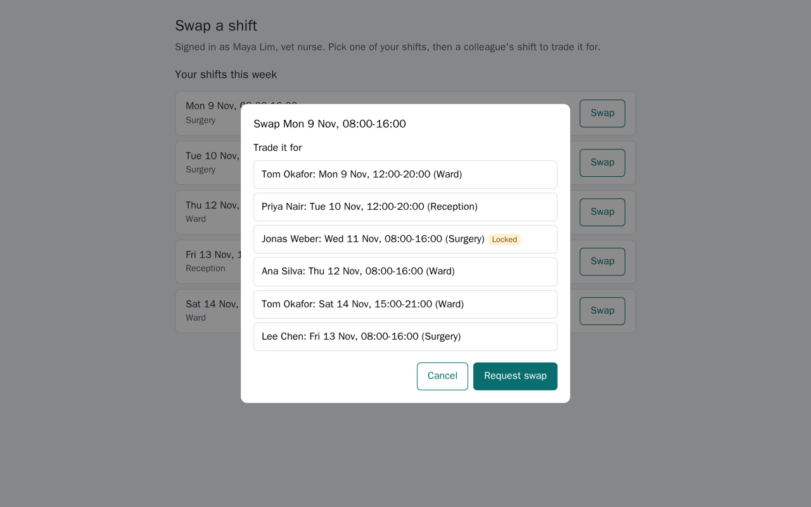
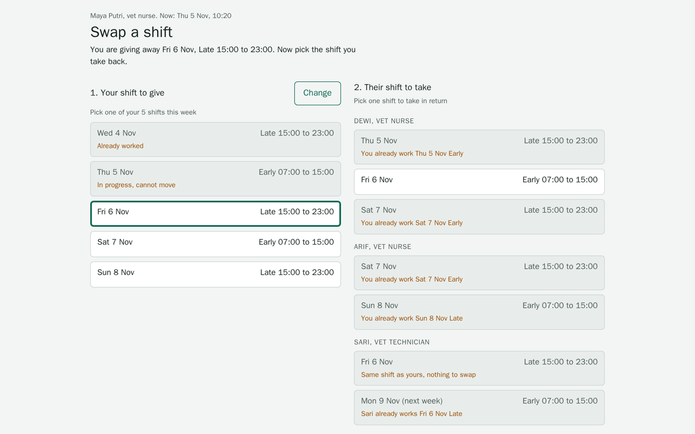
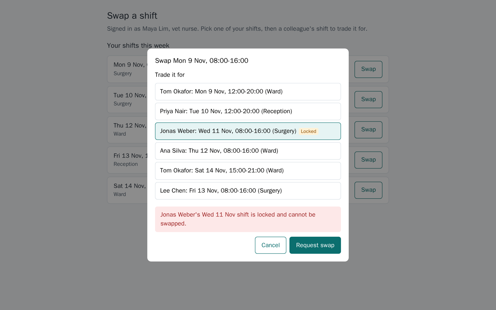
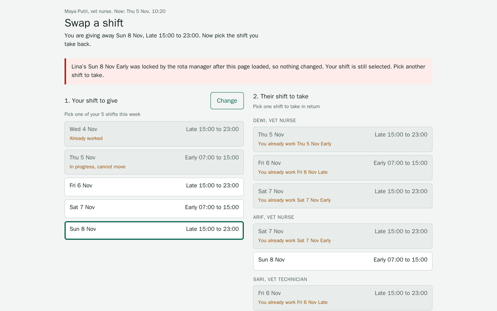
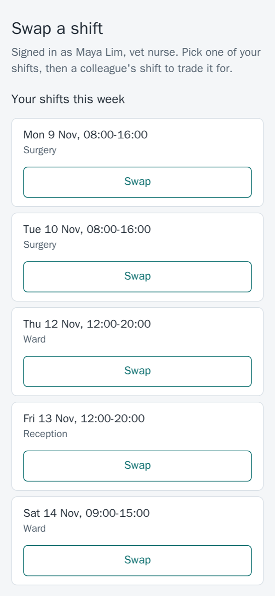
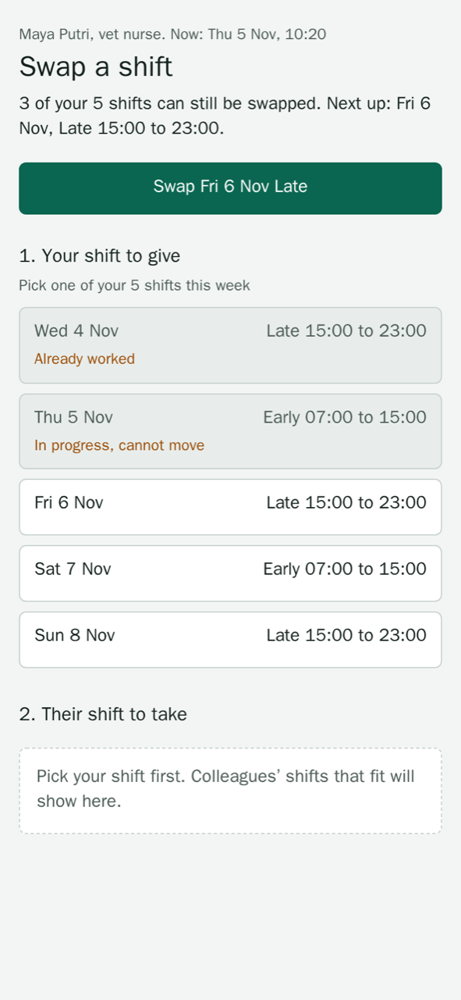

# no-fake-done

Your agent says "Done, all 20 tests pass." You merge it ten minutes before the demo. The clinic owner clicks Swap and nothing happens. The tests checked the server, and nobody had opened the page.

`no-fake-done` makes the agent write down what done means before it writes code, then hand back the work, as a PR or a plain message, where every line of that list has its proof or says Not verified.

Runs a change from a one-line request to a PR, and makes every claim on the way carry proof: a test, a command and its output, a screenshot, a step someone can repeat. When the change touches a screen, it hands the look to `no-template-ui` and the check to `no-broken-ui`.

```sh
npx skills add fajarhide/no-fake-done --skill no-fake-done -g
```

Install all three skills to get the screen steps. Without the other two, the agent still writes the spec and the PR table, and it marks the screen rows Not verified.

## What it changes

We gave agents the same two prompts with and without the skill, first to see where they go wrong on their own. These agents already had strict global instructions about verifying work, so the baseline is stronger than a fresh install.

| Failure seen without the skill | Runs | What the skill puts in its place |
| --- | --- | --- |
| The plan stays in the agent's head, with no acceptance criteria anyone can check | 2 of 2 | A spec file on disk, where every acceptance row names its proof |
| A request and accept flow, a new table and a migration, chosen silently for "I need it today" | 2 of 2 | Both designs in one line each, the smaller one built, the other listed under Not doing |
| Empty, failure, phone and keyboard states never specified | 4 of 4 | A screen states table filled in before any code |
| An unrequested refactor shipped in the same PR | 2 of 2 | Every changed line traces to an acceptance row, anything else is split out |
| "Done" said about a button nobody had seen in a browser | 1 of 2 | A screen that changed is walked in a real browser, or the row is Not verified |

## A real repo, seven runs

Seven agents got the same small Bun and SQLite app, the same request ("add a way for two staff to swap a shift with each other. I need it today, keep it moving.") and the same browser on a remote machine. Four read this skill first. Afterwards we ran every final commit ourselves, loaded the page and counted what it showed.

| | Without the skill (3 runs) | With the skill (4 runs) |
| --- | --- | --- |
| Spec on disk with proof per row | 0 | 4 |
| PR body with a proof table, Not verified and Not doing | 0 | 4 |
| Agent walked the flow in a browser | 0 | 3 |
| Tests at the end | 5, 5, 7 | 11, 16, 11, 12 |
| Page renders when we load it | 3 | 3 |
| Rewrote the existing render function nobody asked about | 0 | 2 |
| Minutes | 1.6 to 2.3 | 2.1 to 9.5 |

The skill lost on two rows. Two runs rewrote the list renderer while adding swap buttons, and one committed an empty `index.html`, so its page was blank. That run had said plainly that it never opened the page. After this round the skill gained three lines: extend code before replacing it, fetch each changed page over HTTP when no browser can run, and on a shared machine stop only your own processes. A rerun, below, tested them.

Our setup had its own fault. The ports we handed to four of the seven runs were already taken on the shared test machine, so three of them could not open a browser (one with the skill worked around it). We reran one run per side on free ports. Every run chose a request and accept flow over a direct swap, with the reason that a direct swap moves a shift its owner never agreed to.

A rerun on 2026-11-07 tested those three lines: three runs with the skill as it is now, the same app and request, free ports on a remote machine, and a newer model. None rewrote the renderer. All three committed a spec and a PR with proof, Not verified and Not doing, walked the flow in a browser, and passed their own tests at the final commit (9 or 10). We did not load each final page with `judge.py` this time, so the blank page row is not measured for these runs. Three more runs with an extra rule, list every file and function you will touch before the first edit, came out the same on every row while their diffs grew from about 230 to about 350 lines and they took twice as long, so that rule was not added.

## Five traps, sixty runs

The [fake-done bench](../../evals/fake-done-bench/README.md) gives an agent five small requests, each with a bug a quick look misses, and checks the last commit in a browser. On 2026-11-08 we ran it with Claude Code agents that had no personal instructions, memory or other skills, three runs per task.

| Opus 5.5, 15 runs each | Without the skill | Skill before the small path | Skill with the small path |
| --- | --- | --- | --- |
| Work correct at the last commit | 15 | 15 | 15 |
| Final message carries a proof table | 0 | 15 | 15 |
| Final message names what it did not check | 0 | 10 | 11 |
| Spec on disk that passes `proof.py` | 0 | 14 | 15 |
| Seconds, average | 54 | 231 | 102 |
| Cost per run | $0.31 | $0.89 | $0.56 |

Without the skill, every run found its bug too: these traps are too easy for current models, and Haiku 5.5 also passed 15 of 15. So this bench does not show the skill making the work more correct. What it changes is what a reviewer gets: proof for each claim, a list of what was not checked, and a spec CI can check. The small path, a short route for changes that stay inside an existing screen, cut the cost by 37% and the time by more than half while keeping all of that.

## One brief, built twice

The brief: "Our vet clinic schedules staff shifts in a web app. Build the screen where a staff member swaps one of their shifts with a colleague. I need it today, keep it moving." Both agents got the same brief, the same fake server (600 ms, rejects a locked shift) and the same access to a browser. One of them also had the three skills. The same script took every screenshot below.

### Picking the shift to take

The agent without the skill lists every colleague shift and leaves the locked one selectable. With the skill, the screen says what you are giving away, and each option that would not work says why: you already work that day, or it is the same shift.

| Without the skill | With the three skills |
| --- | --- |
|  |  |

### When the server says no

Both screens show the error. The second one says what happened, that nothing changed, what it kept and what to do next.

| Without the skill | With the three skills |
| --- | --- |
|  |  |

### On a phone

The first line of the second screen counts what can still be done and offers the next swap as one button.

| Without the skill | With the three skills |
| --- | --- |
|  |  |

### What each agent checked

| | Without the skill | With the three skills |
| --- | --- | --- |
| Opened it in a browser | No | Yes, phone and desktop |
| Forced cases | None | Double-click confirm, server refusal, 390 px width, Tab order |
| Said what it did not test | Yes, everything | Reduced motion, 200% zoom, 320 px, JavaScript off, slow network, reload |
| Time and tokens | 35 s, 50k | 6 min, 78k |

## Check it outside the agent

`scripts/proof.py` reads the proof table in a spec or PR body and fails on empty or filler proof ("looks fine", "TODO"), a file named in backticks that is not in the repo, a Not verified row missing from the Not verified line, or a change git has not committed. It needs only Python, so it works the same whichever agent wrote the PR, in a git hook or in CI (copy the one file into the repo for CI):

```sh
python ~/.claude/skills/no-fake-done/scripts/proof.py PR.md docs/specs/*.md   # exit 1 on any FAIL
python ~/.claude/skills/no-fake-done/scripts/proof.py PR.md --strict             # Not verified rows fail too
python ~/.claude/skills/no-fake-done/scripts/proof.py PR.md --uncommitted-ok  # in a pre-commit hook, where nothing is committed yet
```

It checks that each proof is there and points at something real. `receipts.py`, its old name, still runs it. It does not rerun the test or open the screenshot.

## Limits

This is one build per side, and nobody judged the screenshots blind. It shows what the skill makes an agent do. It does not show by how much the skill wins. The look did not get bolder, because a screen people work in should get clearer, and `no-template-ui` says so. The skill costs time: six minutes against thirty-five seconds here, most of it spent checking. On small changes the small path brings it to about twice the time and 1.8 times the cost of an agent without the skill.
